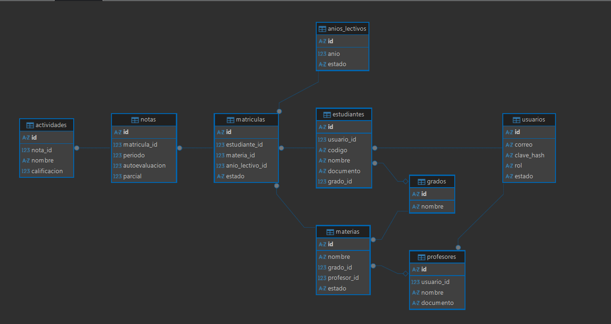
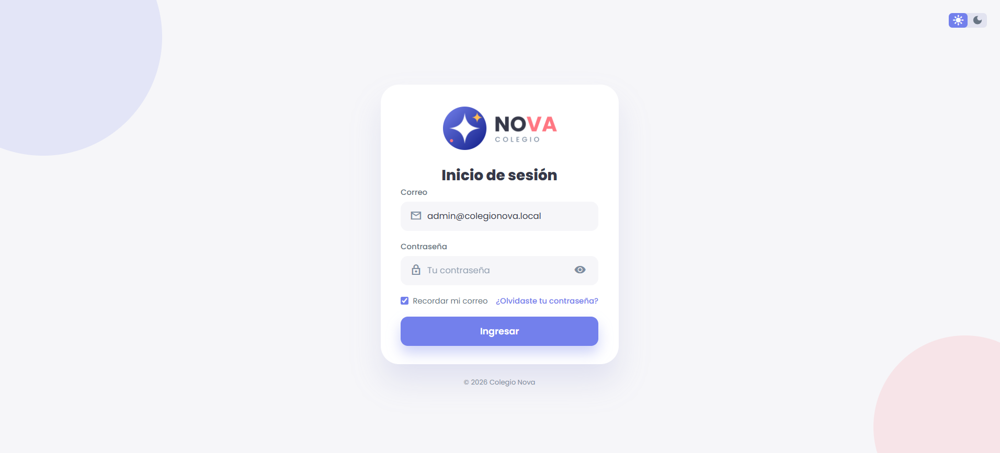

# Sistema de Gestión de Notas de Estudiantes

## 1. Presentación del proyecto

**Sistema de Gestión de Notas** es una aplicación diseñada para administrar de forma centralizada la información académica de los estudiantes de una institución. La plataforma permite que los estudiantes consulten la oferta de cursos y gestionen su matrícula, que los profesores registren y publiquen las calificaciones, y que cada estudiante pueda generar e imprimir su boletín de notas.

El proyecto busca reemplazar procesos manuales (planillas, hojas de cálculo sueltas, papel) por un sistema organizado, accesible y seguro.

## 2. Integrantes

| N.º | Nombre completo | Rol en el proyecto |
|-----|-----------------|--------------------|
| 1 | Brayan Sneyder Arias Bueno | Desarrollador|
| 2 | Jason Andres Torres Rodriguez | Desarrollo front |

## 3. Temática

- **Estudiante:** consulta cursos disponibles, se matricula o cancela su matrícula, revisa sus calificaciones e imprime su boletín.
**Gestión de notas de los estudiantes.**

El sistema maneja dos tipos de usuarios con funciones diferenciadas:

- **Profesor:** accede a los cursos que tiene asignados y sube o actualiza las notas de los estudiantes matriculados.                               

## 4. Objetivos

### Objetivo general

Desarrollar un sistema de información que permita gestionar las notas y la matrícula de cursos de los estudiantes, facilitando el registro de calificaciones por parte de los profesores y la consulta e impresión del boletín por parte de los estudiantes.

### Objetivos específicos

- Diseñar e implementar un módulo de autenticación con roles (estudiante y profesor).
- Permitir a los estudiantes visualizar los cursos disponibles y gestionar su matrícula.
- Permitir a los profesores cargar y modificar las notas de los estudiantes de sus cursos.
- Generar un boletín de notas por estudiante, listo para imprimir.
- Almacenar la información de forma segura y consistente en una base de datos.
- Ofrecer una interfaz clara, intuitiva y fácil de usar.

## 5. Justificación

En muchas instituciones educativas el registro de notas y la matrícula de cursos todavía se realizan de forma manual o con herramientas dispersas, lo que genera:

- Errores de transcripción y pérdida de información.
- Demoras en la entrega de calificaciones a los estudiantes.
- Dificultad para consultar el historial académico.
- Poco control sobre quién puede ver o modificar las notas.

Este proyecto propone una solución que **centraliza la información**, **reduce errores**, **agiliza la consulta** y **da autonomía al estudiante** para gestionar su matrícula y obtener su boletín cuando lo necesite. Además, controla los permisos por rol, de modo que solo los profesores puedan registrar notas y cada estudiante solo vea su propia información.

## 6. Requerimientos funcionales

| Código | Requerimiento | Actor |
|--------|---------------|-------|
| RF-01 | El sistema debe permitir iniciar y cerrar sesión con usuario y contraseña. | Todos |
| RF-02 | El sistema debe diferenciar los permisos según el rol (estudiante o profesor). | Todos |
| RF-03 | El estudiante debe poder ver la lista de cursos disponibles con su información (nombre, código, profesor, cupos). | Estudiante |
| RF-04 | El estudiante debe poder matricularse en un curso disponible. | Estudiante |
| RF-05 | El estudiante debe poder cancelar su matrícula en un curso. | Estudiante |
| RF-06 | El estudiante debe poder ver los cursos en los que está matriculado. | Estudiante |
| RF-07 | El estudiante debe poder consultar sus notas por curso. | Estudiante |
| RF-08 | El estudiante debe poder generar e imprimir su boletín de notas. | Estudiante |
| RF-09 | El profesor debe poder ver los cursos que tiene asignados y los estudiantes matriculados en cada uno. | Profesor |
| RF-10 | El profesor debe poder subir las notas de los estudiantes de sus cursos. | Profesor |
| RF-11 | El profesor debe poder modificar notas ya registradas. | Profesor |
| RF-12 | El sistema debe calcular automáticamente el promedio o definitiva de cada curso. | Sistema |
| RF-13 | El sistema debe validar que las notas estén dentro del rango permitido (por ejemplo, de 0.0 a 5.0). | Sistema |

## 7. Requerimientos no funcionales

| Código | Categoría | Requerimiento |
|--------|-----------|---------------|
| RNF-01 | Usabilidad | La interfaz debe ser clara, intuitiva y fácil de aprender para estudiantes y profesores. |
| RNF-02 | Seguridad | Las contraseñas deben almacenarse cifradas y el acceso debe estar restringido según el rol. |
| RNF-03 | Privacidad | Un estudiante solo puede consultar su propia información académica. |
| RNF-04 | Rendimiento | Las consultas y operaciones principales deben responder en menos de 3 segundos en condiciones normales. |
| RNF-05 | Disponibilidad | El sistema debe estar disponible durante los periodos de matrícula y de publicación de notas. |
| RNF-06 | Compatibilidad | La aplicación debe funcionar correctamente en los navegadores modernos (Chrome, Firefox, Edge). |
| RNF-07 | Responsividad | La interfaz debe adaptarse a distintos tamaños de pantalla. |
| RNF-08 | Mantenibilidad | El código debe estar organizado, documentado y ser fácil de modificar o ampliar. |
| RNF-09 | Integridad | Los datos deben mantenerse consistentes; no debe permitirse registrar notas de estudiantes no matriculados. |
| RNF-10 | Impresión | El boletín debe tener un formato legible y adecuado para impresión en tamaño carta o A4. |

## 8. Tecnologías *(opcional, completar según el proyecto)*

- Lenguaje(s): Node.js, express.js
- Base de datos: PostgreSQL
- Herramientas: Git y GitHub


## 9. Diagrama de la base de datos


## 10. Diseño del login


## 12. Estrutura del proyecto 
COLEGIO_NOVA/
│
├── frontend/
│   ├── vistas/
│   │   ├── login/
│   │   │   └── login.html
│   │   │
│   │   ├── administrador/
│   │   │   ├── db_admin.html
│   │   │   ├── estudiantes/
│   │   │   ├── profesores/
│   │   │   ├── materias/
│   │   │   ├── matriculas/
│   │   │   └── notas/
│   │   │
│   │   ├── estudiante/
│   │   │   └── db_estudiante.html
│   │   │
│   │   └── profesor/
│   │       └── db_profesor.html
│   │
│   ├── controladores/
│   ├── modelos/
│   ├── css/
│   ├── img/
│   ├── js/
│   └── index.html
│
├── backend/
│   ├── config/
│   ├── modulos/
│   │   ├── autenticacion/
│   │   ├── usuarios/
│   │   ├── estudiantes/
│   │   ├── profesores/
│   │   ├── materias/
│   │   ├── matriculas/
│   │   └── notas/
│   │
│   ├── middleware/
│   ├── server.js
│   └── package.json
│
└── database/
   ├── migraciones/
   ├── DB_COLEGIO

## 13. Cómo ejecutar el proyecto (front + backend + base de datos)

**Requisitos:** Node.js 20.12 o superior y PostgreSQL con la base `DB_COLEGIO` (esquema original).

```bash
cd backend
npm install
# Configura la conexión en backend/.env (hay un ejemplo en .env.example)
npm run crear-admin -- correo@dominio.com TuClave "Tu Nombre"   # solo la primera vez
npm start
```

Abre **http://localhost:3000** (el backend también sirve el front). Con Live Server (puerto 5501) también funciona si el backend corre en el 3000.

**Primera vez con datos que ya tenías en el navegador:** inicia sesión como administrador desde el mismo navegador/dirección donde estaban. Se suben solos a la base de datos (sin borrar nada del navegador).

### Cómo se guardan los datos (tablas reales de DB_COLEGIO)
| Pantalla | Tablas |
|----------|--------|
| Estudiantes | `usuarios` (rol estudiante) + `estudiantes` + `grados` |
| Profesores | `usuarios` (rol profesor) + `profesores` (la materia va en `especialidad`) |
| Materias | `materias` + `grados` |
| Matrículas | `matriculas` (usa el año lectivo activo de `anios_lectivos`) |
| Notas | `notas` + `actividades` (al borrar una nota se **anula**, no se elimina) |

- Se respetan tus restricciones, triggers de validación y la auditoría (`auditoria_cambios` registra quién hizo cada cambio).
- Los ids que genera el front (p. ej. `est-lq3x9`) se relacionan con los ids reales en la tabla `nova_ids`; `nova_versiones` evita que dos guardados simultáneos se pisen.
- Lo que el panel guardó antes en `nova_datos` se pasa solo a las tablas reales al arrancar (y `nova_datos` queda como copia).
- Eliminar un estudiante, profesor o materia con registros asociados no se permite (tus llaves foráneas son RESTRICT): se pide cambiarlo a Inactivo.
- `npm run diagnostico` muestra la estructura real de la base.
- Respaldo recomendado: `pg_dump -U postgres -d DB_COLEGIO -f respaldo.sql`

### API
| Método | Ruta | Descripción |
|--------|------|-------------|
| POST | `/api/auth/login` | Inicia sesión (administrador, profesor o estudiante) y devuelve un token |
| GET | `/api/datos` | Datos que el rol puede ver (un estudiante solo ve lo suyo) |
| PUT | `/api/datos/:clave` | Guarda una colección (respetando los permisos del rol) |
| GET | `/api/salud` | Comprueba que el servidor responde |

